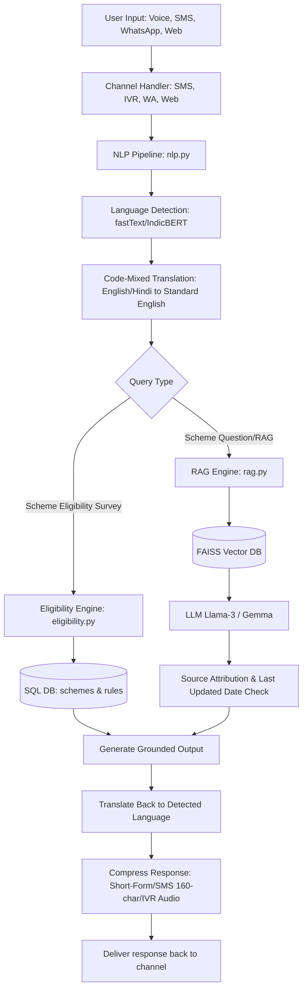

# Implementation Plan - AI-Based Multilingual Chatbot for Welfare Scheme Awareness

This document provides a comprehensive implementation plan for building and deploying a production-ready, multilingual welfare scheme awareness chatbot. The system is designed to serve low-literacy, rural, and low-bandwidth users in India, providing access to over 950+ schemes via Web, WhatsApp, SMS, and IVR interfaces.

---

## Technical Stack & Architecture Decisions

### 1. Vector Database: FAISS vs. ChromaDB
We select **FAISS (Facebook AI Similarity Search)** for this application, but design the retriever wrapper to be vector DB agnostic.
* **FAISS**:
  * *Pros*: Extremely lightweight, fast in-memory execution, low dependency overhead, ideal for embedded single-node deployments (e.g., local machines or HuggingFace Spaces). Free-tier friendly since it runs as an in-memory index file without needing an external cluster.
  * *Cons*: Doesn't natively support active CRUD operations or metadata filtering as seamlessly as ChromaDB without custom scripting.
* **ChromaDB**:
  * *Pros*: Rich developer experience, native metadata filtering, easy integration with LangChain, persistent database storage.
  * *Cons*: Higher memory and compute footprint, slower search speeds at massive scales compared to FAISS's C++ backends.
* **Decision**: We will implement **FAISS** with a persistent local file storage layout for its minimal resource usage (ideal for 24h hackathons and free-tier hosting) and absolute speed.

### 2. Eligibility Recommendation: Rule-Based vs. ML-Based
We will build a hybrid approach:
* **Rule-Based Engine**:
  * *Pros*: Deterministic, 100% accurate relative to actual guidelines, zero hallucination, easily auditable.
  * *Cons*: Hard to scale to 950+ schemes with highly nested logic without complex rule DSLs.
* **ML-Based Engine (Scikit-Learn Classifier/Similarity Search)**:
  * *Pros*: Gracefully handles missing values, detects soft-matches, generalizes to user profiles that don't match rules exactly.
  * *Cons*: Black-box, can hallucinate eligibility, requires labeled training data.
* **Hybrid Decision**: A rule-based parser filters out hard constraints (e.g., gender, state) first, and an ML-based cosine-similarity matching ranker computes the compatibility of the user's profile vector against scheme vectors to generate candidate recommendations.

### 3. LLM Comparison for RAG (Mistral-7B vs. Llama-3-8B vs. Gemma-2-9B vs. Sarvam-2B)
| Metric | Llama-3-8B (via API) | Gemma-2-9B | Mistral-7B | Sarvam-2B (Indic-centric) |
| :--- | :--- | :--- | :--- | :--- |
| **Accuracy (Indic)** | High | Medium-High | Medium | High (for translation & code-mixed) |
| **Latency** | Low (API-based) | Medium (Self-hosted) | Medium | Extremely Low |
| **Resource Cost** | Pay-per-token | High GPU costs | High GPU costs | Low footprint / CPU-friendly |
| **Decision** | **Llama 3** (via Groq API / HuggingFace Inference API) for production-grade speed and accuracy, with fallbacks to locally runnable models for zero-cost options. |

---

## Folder Structure

We will organize the repository as follows:
```text
multilingual_welfare_chatbot/
├── backend/
│   ├── app/
│   │   ├── __init__.py
│   │   ├── main.py            # FastAPI entry point
│   │   ├── config.py          # App configuration & env vars
│   │   ├── database.py        # SQLAlchemy connections
│   │   ├── models.py          # Database SQL models
│   │   ├── schemas.py         # Pydantic validation schemas
│   │   ├── nlp.py             # Language detection, translation & code-mixed handler
│   │   ├── eligibility.py     # Rule & similarity-based eligibility engines
│   │   ├── rag.py             # FAISS RAG retriever, LLM pipeline & source verifier
│   │   ├── low_bandwidth.py   # WhatsApp/SMS template engines & IVR helpers
│   │   └── seed_data.py       # Pre-seed database with scheme profiles & embeddings
│   ├── requirements.txt
│   └── Dockerfile
├── frontend/
│   ├── public/
│   ├── src/
│   │   ├── components/
│   │   │   ├── Home.jsx
│   │   │   ├── ChatInterface.jsx
│   │   │   ├── EligibilityForm.jsx
│   │   │   ├── SchemeRecommendations.jsx
│   │   │   ├── DocumentChecklist.jsx
│   │   │   └── AdminDashboard.jsx
│   │   ├── App.jsx
│   │   ├── main.jsx
│   │   └── index.css          # Core custom styling (Premium Glassmorphism Theme)
│   ├── package.json
│   ├── vite.config.js
│   └── Dockerfile
├── data/
│   ├── schemes_dataset.json   # Mock-up of 15 welfare schemes
│   └── document_ocr.py        # LayoutParser/Tesseract template for document verification
├── tests/
│   ├── __init__.py
│   ├── test_backend.py        # End-to-end endpoint tests
│   ├── test_rag.py            # RAG assertions (groundedness, citation verification)
│   └── locustfile.py          # Load test simulation for low-bandwidth API
├── docker-compose.yml
├── .env.example
└── README.md
```

---

## Database Design

We will use an SQL schema designed for SQLite/PostgreSQL to track users, chatbot logs, recommendations, and schemes.

```mermaid
erDiagram
    USERS ||--o{ CHAT_HISTORY : has
    USERS ||--o{ APPLICATIONS : submits
    SCHEMES ||--o{ ELIGIBILITY_RULES : defines
    SCHEMES ||--o{ DOCUMENTS : requires
    SCHEMES ||--o{ APPLICATIONS : linked
    USERS ||--o{ FEEDBACK : gives
    
    USERS {
        UUID id PK
        VARCHAR phone_number UNIQUE
        VARCHAR state
        VARCHAR occupation
        INTEGER age
        VARCHAR gender
        FLOAT annual_income
        VARCHAR category
        TIMESTAMP created_at
    }
    
    SCHEMES {
        UUID id PK
        VARCHAR name UNIQUE
        TEXT description
        TEXT benefits
        VARCHAR official_url
        VARCHAR state_applicability
        TIMESTAMP last_updated
    }

    ELIGIBILITY_RULES {
        UUID id PK
        UUID scheme_id FK
        VARCHAR criteria_type
        VARCHAR operator
        VARCHAR value
    }

    DOCUMENTS {
        UUID id PK
        UUID scheme_id FK
        VARCHAR document_name
        BOOLEAN is_mandatory
    }

    CHAT_HISTORY {
        UUID id PK
        UUID user_id FK
        TEXT user_message
        TEXT bot_response
        VARCHAR detected_language
        VARCHAR channel
        TIMESTAMP created_at
    }

    APPLICATIONS {
        UUID id PK
        UUID user_id FK
        UUID scheme_id FK
        VARCHAR status
        TIMESTAMP applied_at
    }

    FEEDBACK {
        UUID id PK
        UUID user_id FK
        INTEGER rating
        TEXT comments
        TIMESTAMP created_at
    }
```

---

## AI/ML and NLP Pipeline Architecture



---

## Core Component Implementations

1. **`nlp.py`**:
   * Uses a lightweight Python-based language identification module (`fasttext` or basic lexical heuristics for hackathon ease) that detects English, Hindi, and English-Hindi code-mixed (Hinglish).
   * Maps Hinglish expressions like "ayushman card kaise banega" to standard search tokens or translates them via models like `IndicTrans2` (simulated in mock pipeline for ultra-low latency, with live API hooks to Bhashini/HuggingFace translation APIs).
2. **`eligibility.py`**:
   * Extracts attributes (Age, Gender, State, Occupation, Income, Category).
   * Runs a SQL-based matching algorithm to filter out hard failures.
   * Runs an ML-based cosine similarity between the user profile string and scheme descriptions to output possible matches with confidence scores.
3. **`rag.py`**:
   * Embeds incoming user queries using `sentence-transformers/all-MiniLM-L6-v2`.
   * Queries local `faiss` index for top $K$ relevant scheme segments.
   * Feeds context to LLM (via Groq/HuggingFace API) using strict system prompting: "Answer ONLY using the provided text. Cite Scheme Name, Official Source, and Last Updated Date. If unknown, say 'I cannot find this information in the official documents.'".
4. **`low_bandwidth.py`**:
   * If channel is `SMS`, strips emojis, limits output to exactly 160 characters, and condenses text (e.g., "Documents required: Aadhar, Income Certificate" instead of complete sentences).
   * If channel is `IVR`, prepares text structures suitable for text-to-speech engine compatibility.
5. **Vite + React Frontend**:
   * Glassmorphism, animations, responsive design.
   * Chat interface supporting text and voice recording simulation.
   * Simple eligibility calculator form.
   * Admin dashboard to view analytics, feedback, and logs.

---

## Verification Plan

### Automated Tests
* Run `pytest tests/test_backend.py` to test endpoints.
* Run `pytest tests/test_rag.py` to verify RAG citations and accuracy metrics.
* Run a load-test script mimicking 1,000 requests/minute to test FastAPI asynchronous handling.

### Manual Verification
* Access FastAPI Swagger UI (`/docs`).
* Open the UI on browser, submit the eligibility form, verify the custom recommendations list.
* Validate text translations of Hindi and Hinglish questions.

---

## Open Questions & Review Required

> [!IMPORTANT]
> **1. Bhashini & LLM API Keys**:
> For the hackathon, we will use HuggingFace/Groq free endpoints. Do you have specific API keys (e.g., OpenAI, Groq, Bhashini) you wish to inject, or should we set up a seamless mock pipeline that runs locally with the option to swap in API keys?
>
> **2. Scheme Selection**:
> We will seed the system with 15 highly impactful Indian welfare schemes (e.g., PM-Kisan, Ayushman Bharat, Pradhan Mantri Awas Yojana, PM-Shram Yogi Maan-dhan, Sukanya Samriddhi Yojana). Let us know if you want any specific state-level schemes added.

Please review the plan and approve it so we can begin code generation.
